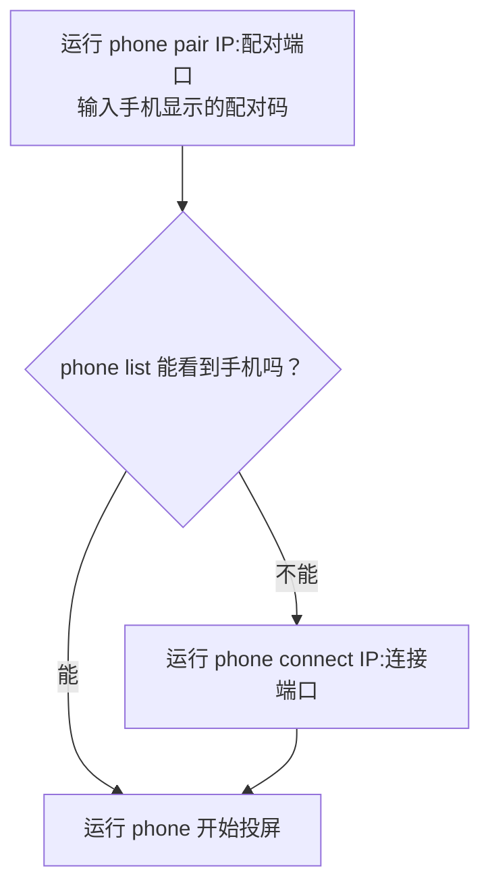
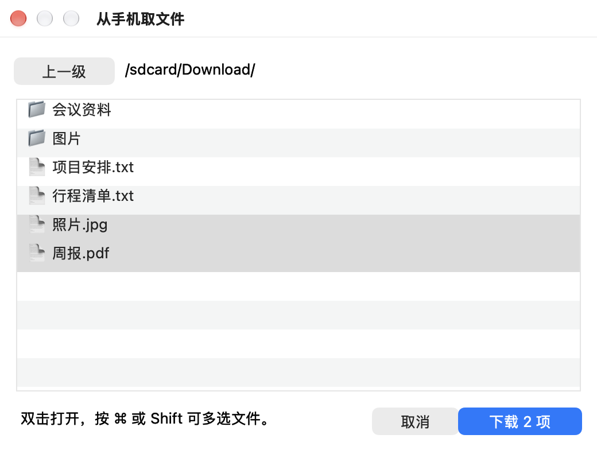

# phone-mirror

在 Mac 上控制 Android 手机，或批量收发文件。投屏使用 scrcpy，文件传输使用 adb，支持 USB 和 Wi-Fi。

## 安装

需要 Homebrew 和 Xcode 命令行工具。

```sh
brew tap --custom-remote 2021dt/phone-mirror https://github.com/2021Dt/phone-mirror.git
if brew command trust >/dev/null 2>&1; then
  brew trust --formula 2021dt/phone-mirror/phone-mirror
fi
brew install 2021dt/phone-mirror/phone-mirror
command -v adb >/dev/null || brew install --cask android-platform-tools
```

## 连接手机

1. 在手机的「开发者选项」中打开 **USB 调试**。
2. 用数据线连接 Mac，解锁手机，点 **允许 USB 调试**。
3. 在 Mac 终端运行 `phone`。投屏期间，手机屏幕默认熄灭，系统保持唤醒。需要亮屏投屏时，运行 `phone --screen-on`。

连接多台手机时，用 `phone list` 查看序列号，再用 `phone -s 序列号` 指定设备。

<details>
<summary>通过 Wi-Fi 连接（Android 11 及以上）</summary>

让手机和 Mac 接入同一个可信的 Wi-Fi，打开手机的「开发者选项 → 无线调试」。**配对端口**在「使用配对码配对设备」弹窗中，**连接端口**在「无线调试」主页面。



</details>

## 窗口快捷键

先点一下投屏窗口。

| 按键 | 操作 |
| --- | --- |
| `⌘1` / `⌘2` | 回到手机桌面 / 打开最近使用的 App |
| 左 `Option+B` | 返回上一页 |
| 左 `Option+V` | 粘贴 Mac 剪贴板中的文字，也可用于输入中文 |
| `⌘U` | 从 Mac 选文件，发送到手机的「下载」 |
| `⌘D` | 从手机选文件，保存到 Mac，默认在 `~/Downloads` |
| `⌘,` | 更改 Mac 接收文件的默认目录 |

## 批量传文件



- **多选**　按住 ⌘ 逐个点选，或按住 Shift 连选。图中点「下载 2 项」即可取回两个文件。上传时也可以多选。
- **找照片**　下载窗口从手机的「下载」目录打开。点「上一级」，进入 `DCIM/Camera` 可找相机照片。
- **重名文件**　自动保留两份，例如 `照片.jpg` 和 `照片 (1).jpg`。

只传文件时，可以直接用终端。输入 `phone send` 并留一个空格，还可以把 Finder 中选好的文件拖进来。

```sh
phone send 周报.pdf 照片.jpg                # 发到手机的「下载」
phone get 周报.pdf 照片.jpg --to ~/Desktop  # 从手机取回，存到 Mac 桌面
```

## 更新与帮助

- 更新 phone-mirror　`brew update && brew upgrade 2021dt/phone-mirror/phone-mirror`
- 单独更新 scrcpy　`phone update`
- 查看所有选项和快捷键　`phone -h`
